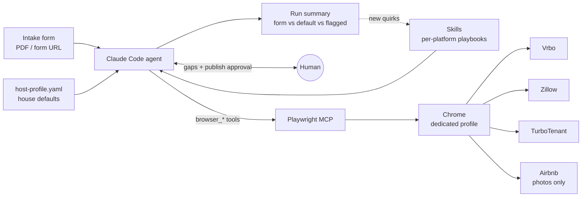

# rental-listing-agent

A Claude Code agent that takes a property intake form and publishes the listing on Vrbo, Zillow Rental Manager and TurboTenant. It also keeps listing photos clean and in the same order across platforms, Airbnb included.

I built it for a short-term and corporate rental business I freelance for. This repo is the generalized version: business-specific values live in one config file, so anyone can use it.

## What it does and who it's for

**For:** small hosts and property managers who list the same unit on several platforms and do it by hand.

**The problem:** one listing means four wizards, 20–40 screens each, the same data typed four times, and every platform has its own traps. Vrbo caps minimum stay at 27 nights in the wizard. Zillow quietly flips a month-to-month lease to "1 year." TurboTenant calls a single unit a "Condo." It's slow, and mistakes are easy to make.

**What the agent does:**

| Skill | Job |
|---|---|
| `vrbo-listing` | Intake form → full Vrbo wizard → publish → post-publish fix-ups (min stay, fees, booking type, welcome guide) |
| `zillow-listing` | Intake form → Zillow Rental Manager wizard → publish |
| `turbotenant-listing` | Intake form → TurboTenant wizard → publish |
| `listing-photo-sync` | Remove bad photos, add new ones, dedupe, or "delete everything after this photo," across all four platforms |
| `listing-photo-order` | Reorder a live listing's photos into a room-by-room walkthrough |
| `listing-update-summary` | Write a plain-text "here's what I changed" message for the owner |
| `open-automation-profile` | Open the agent's browser so you can log in or watch it work |

It writes the title and description itself, checks nearby landmarks and commute times with a web search (it never makes them up), and pauses once before publishing for you to approve.

## How it's built

- **Framework:** Claude Code. Each skill is a `SKILL.md` playbook loaded only when it's needed. There's no app code.
- **Tools:** [Playwright MCP](https://github.com/microsoft/playwright-mcp) drives a real Chrome browser. Claude Code's built-in tools cover PDF reading, web search, `curl` for photo thumbnails, and `AskUserQuestion` for gaps.
- **Single agent, with optional fan-out.** One agent handles one property from start to finish. For batch jobs it starts one subagent per property, so the context (and the cost) doesn't grow with each extra property.
- **Memory, no RAG:**
  - *Procedural memory* = the skills. Every quirk the agent hits gets written back into the skill's "Known quirks" section, so the next run doesn't hit it again.
  - *Config memory* = `host-profile.yaml`: house defaults like fees, pet policy and contact.
  - *Session memory* = a persistent, separate Chrome profile, so logins survive between runs.

  The whole knowledge base fits in a single context, so retrieval would only add a way to fail.



**How the skills were written:** I didn't write selectors by hand. I took screen recordings of each flow being done by hand, pulled the captions (or transcribed the audio locally with mlx-whisper when there were none), sampled frames every 2–3 seconds into contact sheets, and had Claude match the narration to the real screens. Each skill marks which steps were confirmed on screen and which were only narrated, and the agent is told to be more careful on the second kind.

## Key design decision: natural-language playbooks instead of a scripted bot

The obvious approach is a Playwright script with hard-coded selectors. I went with skills: the agent reads the playbook, reads the live page (accessibility tree), and decides what to click.

**Why:**
- These sites change their UI often, and a script breaks on the first renamed button. The playbook says "if the screen doesn't match, trust the screen and flag it," so a moved field causes a question instead of a crash.
- Half the work is judgment, not form-filling: writing copy, choosing the cover photo, sorting 40 photos into rooms, noticing that a form is silent on parking. A script can't do that.
- Updating it means editing Markdown, so a non-engineer can fix a step.

**Tradeoff:** it's slower, costs tokens, and won't do exactly the same thing every run. I built guardrails around that:
- **One human checkpoint, right before Publish.** It's the only step that can't be undone.
- **A hard "never guess" list:** address, bed/bath count, rent, deposit, parking. Everything else falls back to the profile and gets reported as a default.
- **Check the result, don't trust the click.** After writing a field it reads the DOM back, it compares counts before confirming a delete, and it reloads the page to confirm a reorder actually saved.
- **Cost rules:** it checks state from the accessibility tree instead of screenshots, saves vision for photos, reads the intake form once, and uses one subagent per property in batches.

## How I tested it

No unit tests. It runs against live third-party sites on real accounts, so I tested on real listings with a human approving each publish.

- **Live runs.** I ran the skills on the business's real listings. Photo sync ran across 3 properties × 4 platforms in one session.
- **Every run is checked.** The final summary sorts each field into "from the form," "profile default," or "flagged for the owner," so a reviewer can see in seconds what was decided and where it came from.
- **Checks built into the run:**
  - Selection count must match the target count before a bulk delete (34/34 in one run).
  - The new photo total must equal the original minus the deleted.
  - Duplicate photos are caught by comparing CDN hashes, not by eye.
  - A reorder only counts as saved after a full page reload.
- **Failures became rules.** Each one is written into the skill with its fix:
  - TurboTenant: several deletes in one JS call removed one photo, not N (React batches the updates). Now it's one delete per call, with a recount.
  - An upload that "didn't work" had actually worked late, and the retry doubled it. Now it rechecks the count before retrying.
  - Using a stale DOM index deleted the wrong photo once. Now it re-queries right before each action and checks the confirm dialog first.
  - Zillow's credit-score dropdown looked set but reverted. Now it types real keystrokes and reads the value back from the DOM.
- **Efficiency.** A Vrbo reorder of 42 photos took 27 drags instead of the naive 41, because it re-uses the same blocking tile as the drop target until that tile reaches its own spot.

**What I'd add next:** offline evals. Save DOM snapshots of each wizard screen, write synthetic intake forms with planted gaps, and score field accuracy, whether it asks when it should (instead of guessing), and tool calls per listing. That would let me change a skill and catch regressions without touching a live account.

## Setup

1. **Install Playwright MCP** with a dedicated profile (example: `config/playwright-mcp.example.json`):
   ```bash
   cp config/playwright-mcp.example.json ~/.claude/playwright-mcp-config.json   # edit userDataDir
   claude mcp add playwright -- npx @playwright/mcp@latest --config ~/.claude/playwright-mcp-config.json
   ```
   The skills expect the server to be named `playwright`.
2. **Install the skills** from inside Claude Code:
   ```
   /plugin install rental-listing-agent --marketplace transcendfrontiers/rental-listing-agent
   ```
   Or clone the repo and run `claude --plugin-dir ./rental-listing-agent`, or copy `skills/*` into `~/.claude/skills/`.
3. **Set your defaults.** Copy `config/host-profile.example.yaml` to `host-profile.yaml` in the folder you run Claude from, and edit it.
4. **Log in once.** Run `/open-automation-profile`, sign into each platform, then close the window.
5. **Run it:**
   ```
   /vrbo-listing ~/Downloads/123-main-st-intake.pdf
   ```
   A blank intake form is in `examples/intake-form-template.md`.

## Caveats

- These skills drive real accounts and publish real listings. Read the pre-publish summary before you approve.
- Platform UIs change. Labels are accurate as of Aug–Sep 2026. When a skill hits a mismatch it will stop and ask; update the skill when that happens.
- The agent never tries to get past login walls or bot checks. Those are yours to clear.
- Check each platform's terms of service on automation before using this on your account.

## License

MIT
